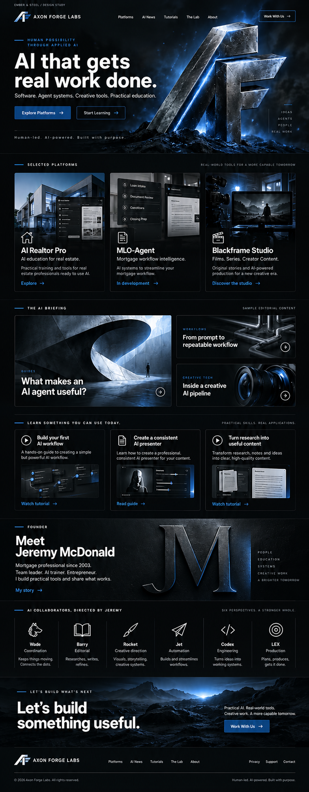

# Axon Forge Labs approved website design

**Approved visual direction, October 22, 2026. Image mockup only.**

Jeremy selected homepage concept 1 and requested navy blue in place of orange. The selected layout, metallic AF mark, typography, and scrolling section structure remain the website direction. The other four concepts and original orange version are retained as historical exploration.

## Approved homepage

The image shows proposed appearance, not a completed website update. Product interfaces, news cards, tutorial thumbnails and related imagery are illustrative. They do not establish live features, finished tutorials or published articles. The JM monogram is a design treatment, not an approved founder portrait.

## Planning references

- [Website page and content plan](WEBSITE_PLAN.md)
- [Brand specification](BRAND_AND_LAYOUT.md)
- [Proposed design tokens](design-tokens.json)
- [Asset manifest and SHA-256 hashes](asset-manifest.json)
- [Five original homepage concepts](exploration/README.md)

## Related platform

AxonBotOS uses the same brand direction with matched dark and light app layouts. Its approved interface mockups and platform documentation belong in the separate [AxonBotOS repository](https://github.com/jeremymac904/AxonBotOS), which requires repository access. The website repository is not the platform application codebase.

## Delivery boundary

This package adds design references and planning documents only. It does not modify application source, production configuration, accounts, schedules or deployed behavior. The detailed internal audit and coordination notes remain in the existing Brain Vault project record. Production logo exports, final copy, actual product imagery, accessibility checks and implementation remain separate work.
